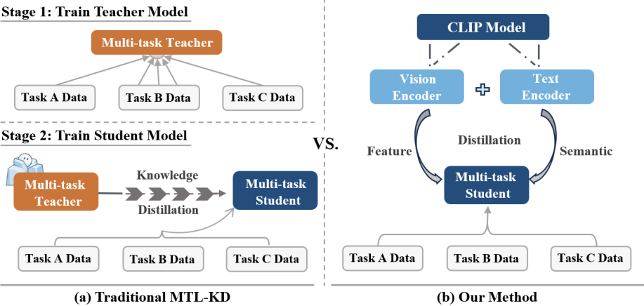
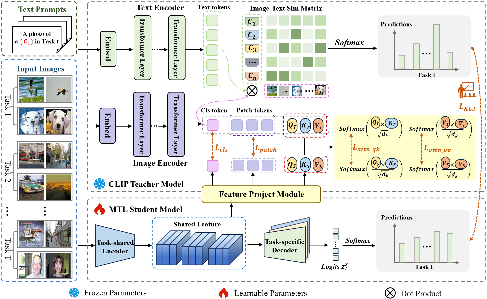
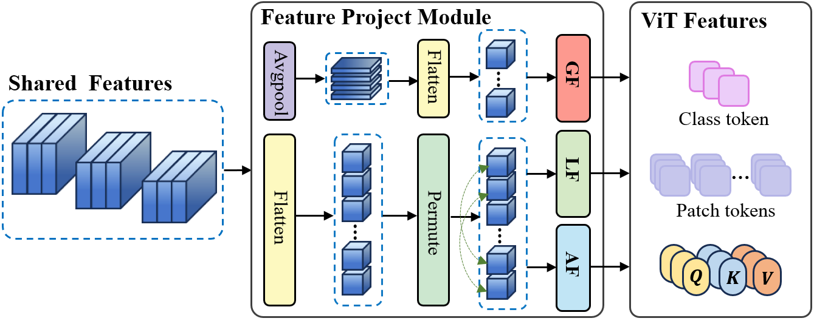
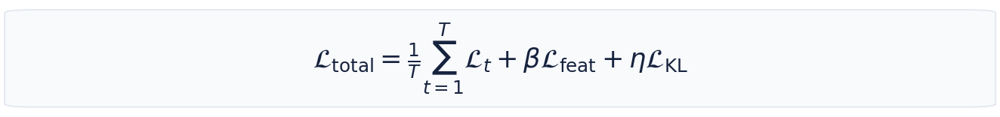
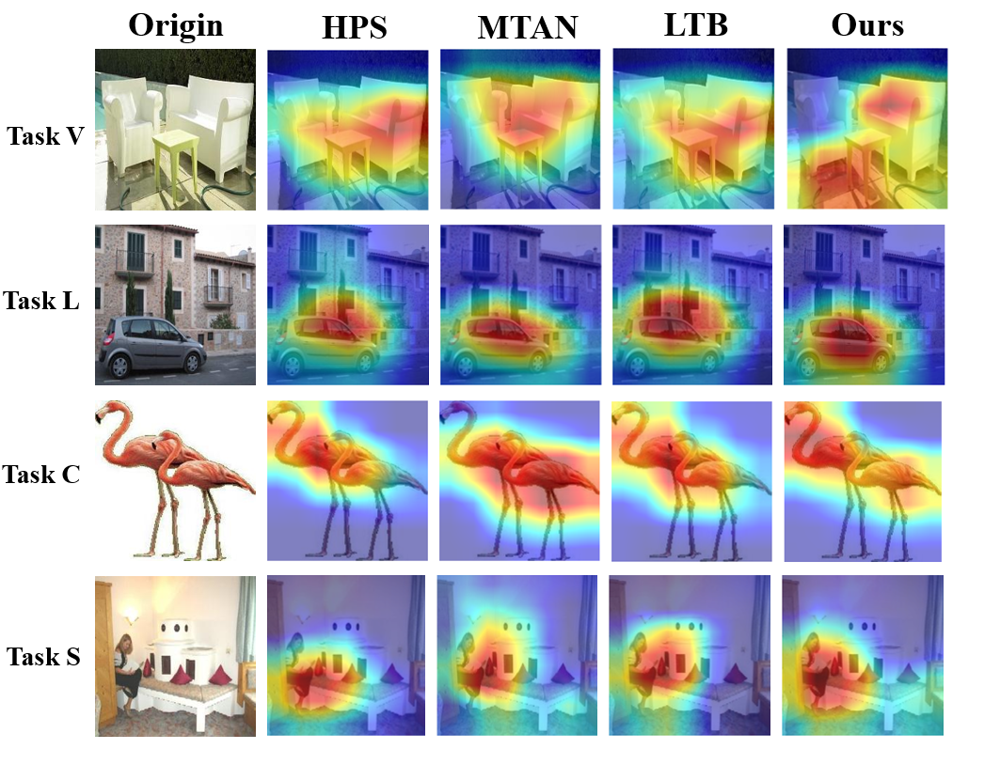

<div align="center">

<h1>Unleashing the Power of CLIP as a General Teacher<br>for Multi-Task Learning</h1>

<p><strong>ACM Multimedia 2026 (ACM MM '26)</strong></p>

<p>
Yayu Zhang<sup>*</sup> &nbsp;·&nbsp;
<a href="https://github.com/Jinglong-Zuo1127"><strong>Jinlong Zuo<sup>*</sup></strong></a> &nbsp;·&nbsp;
Yuhua Qian<sup>✉</sup> &nbsp;·&nbsp;
Jixian Li &nbsp;·&nbsp; Nan Li
</p>

<p><sub>Shanxi University &nbsp;|&nbsp; * Equal contribution &nbsp;|&nbsp; ✉ Corresponding author</sub></p>

<p>
<a href="https://doi.org/10.1145/3767308.3835223"></a>
<a href="https://github.com/Jinglong-Zuo1127/CMKD"></a>
<a href="./assets/poster.png"></a>

</p>

</div>

<p align="center">
  
</p>

**CMKD** is a CLIP-based multi-task knowledge distillation framework. Rather than training a task-specific teacher for each downstream problem, CMKD uses **frozen, pretrained CLIP as a general teacher**, transferring visual knowledge and image–text semantics to a multi-task student through two complementary distillation paths.

## At a Glance

- **General teacher.** A single pretrained CLIP model provides transferable supervision, without additional downstream teacher training.
- **Representation distillation.** Global, local, and attention-aware projectors bridge the feature gap between CLIP and the student's shared encoder.
- **Semantic distillation.** CLIP's image–text similarity distributions guide task-specific predictions.
- **Four benchmarks.** Validated on **VLCS**, **OfficeHome**, **RadImageNet**, and **MedMNISTv2**.

## Method

CMKD consists of a **frozen CLIP teacher** and a **trainable MTL student**. Its dual-path design transfers knowledge at both the shared-feature and task-output levels:

| Path | What is transferred | How it helps |
| :--- | :--- | :--- |
| **Shared representation distillation** | CLIP's global class token, local patch tokens, and attention-related features | Aligns the student's shared representation with general visual knowledge using **GF**, **LF**, and **AF** projectors. |
| **Task-specific semantic distillation** | CLIP's image–text matching logits | Regularizes each student task head using cross-modal soft targets. |

<details>
<summary><strong>Explore the full CMKD architecture (Figure 3)</strong></summary>
<br>
<p align="center"></p>
<p align="center"><em>Figure 3 of the paper: the frozen CLIP teacher and the multi-task student, connected by the two knowledge-distillation pathways.</em></p>
</details>

<details>
<summary><strong>Explore the feature projection module (Figure 4)</strong></summary>
<br>
<p align="center"></p>
</details>

The total objective is

<p align="center">
  
</p>

## Results

**Average classification accuracy (%)** on four multi-task benchmarks. We compare CMKD against the **MoLA student without CMKD** under the corresponding experimental setting.

| Dataset | MoLA student | **CMKD (Ours)** | Gain |
| :--- | ---: | ---: | ---: |
| VLCS | 84.76 | **87.22** | **+2.46 pp** |
| OfficeHome | 84.02 | **85.66** | **+1.64 pp** |
| RadImageNet | 73.68 | **74.94** | **+1.26 pp** |
| MedMNISTv2 | 87.52 | **88.07** | **+0.55 pp** |

<sub>Results correspond to Tables 1–4 in the paper. Gains are absolute percentage-point differences, not relative percentages. Please refer to the paper for per-task scores, comparisons with other baselines, and ablation studies.</sub>

<details>
<summary><strong>Qualitative analysis · Grad-CAM visualizations</strong></summary>
<br>
<p align="center"></p>
<p align="center"><em>Qualitative comparison on VLCS (paper appendix).</em></p>
</details>

## Model Zoo & Checkpoints

The table below reserves download locations for **trained CMKD student weights**. Checkpoints have **not been published yet**; links will be added once the files are uploaded and verified.

| Dataset | Student backbone | Checkpoint |
| :--- | :--- | :--- |
| **VLCS** | ResNet-50 | *Coming soon* |
| **OfficeHome** | ResNet-50 | *Coming soon* |
| **RadImageNet** | ResNet-18 | *Coming soon* |
| **MedMNISTv2** | ResNet-18 | *Coming soon* |

> **For maintainers:** Upload the final weights to [GitHub Releases](https://github.com/Jinglong-Zuo1127/CMKD/releases) or another reliable model-hosting service, then replace each *Coming soon* entry with its verified download URL. State the checkpoint format, model configuration, and evaluation command alongside the release. No download URLs are active yet.

## Getting Started

### 1. Clone

```bash
git clone https://github.com/Jinglong-Zuo1127/CMKD.git
cd CMKD
```

### 2. Set up the environment

This project is implemented in **PyTorch** and uses a **CLIP ViT-B/16** teacher. The experiments reported in the paper used an **NVIDIA RTX 4090**.

Configure a compatible Python, PyTorch, and CUDA environment, then prepare the datasets. Version-pinned environment files have not yet been included in the public repository.

### 3. Download datasets

| Dataset | Download | Scenario |
| :--- | :--- | :--- |
| VLCS | [Download](https://www.mediafire.com/file/7yv132lgn1v267r/vlcs.tar.gz/file) | Domain heterogeneity |
| OfficeHome | [Download](https://wjdcloud.blob.core.windows.net/dataset/OfficeHome.zip) | Domain heterogeneity |
| RadImageNet | [Official repository](https://github.com/BMEII-AI/RadImageNet) | Multi-input task heterogeneity |
| MedMNISTv2 | [Official repository](https://github.com/MedMNIST/MedMNIST) | Multi-input task heterogeneity |

Set the local dataset paths according to the benchmark loaders before running the experiments.

### 4. Train

For example, the existing VLCS training command is:

```bash
python train.py \
    --benchmark vlcs_resnet50 \
    --balancer ourbase \
    --arch lora_soft_router \
    --lora_layer 1 2 3 \
    --lora_rank 4 4 4 8
```

Outputs are written under `./logs/` by default. The training script also accepts options such as `--epochs`, `--train-batch`, `--test-batch`, and `--output-path`.

<details>
<summary><strong>Repository structure & reproducibility notes</strong></summary>

```text
CMKD/
├── CLIP/                   # CLIP implementation
├── code/
│   ├── benchmarks/         # Benchmark definitions
│   ├── evaluation/         # Evaluation utilities
│   ├── models/             # Student architectures
│   ├── optim/              # Training methods
│   └── utils/              # Utilities
├── layers/                 # Model components
├── train.py                # Training entry point
├── train_vlcs.py           # VLCS-specific training
├── train_officehome.py     # OfficeHome-specific training
├── assets/                 # README images (this package)
└── README.md
```

**Reproducibility note:** The current public code references local data-loading modules and paths (including `code.data.datasets`) that are not bundled in the checked repository structure. Dataset-loader setup and dependency pinning should be completed before claiming out-of-the-box reproduction.

</details>

## Citation

If you find CMKD useful, please consider citing our paper:

```bibtex
@inproceedings{zhang2026unleashing,
  title     = {Unleashing the Power of CLIP as a General Teacher for Multi-Task Learning},
  author    = {Zhang, Yayu and Zuo, Jinlong and Qian, Yuhua and Li, Jixian and Li, Nan},
  booktitle = {Proceedings of the 34th ACM International Conference on Multimedia},
  year      = {2026},
  doi       = {10.1145/3767308.3835223},
  url       = {https://doi.org/10.1145/3767308.3835223}
}
```

## Contact

For questions or issues, feel free to [open an issue](https://github.com/Jinglong-Zuo1127/CMKD/issues) or contact **Jinlong Zuo** ([zuojinlong@sxu.edu.cn](mailto:zuojinlong@sxu.edu.cn)).

---

<div align="center">
<sub>CMKD · ACM Multimedia 2026 · Shanxi University</sub>
</div>
